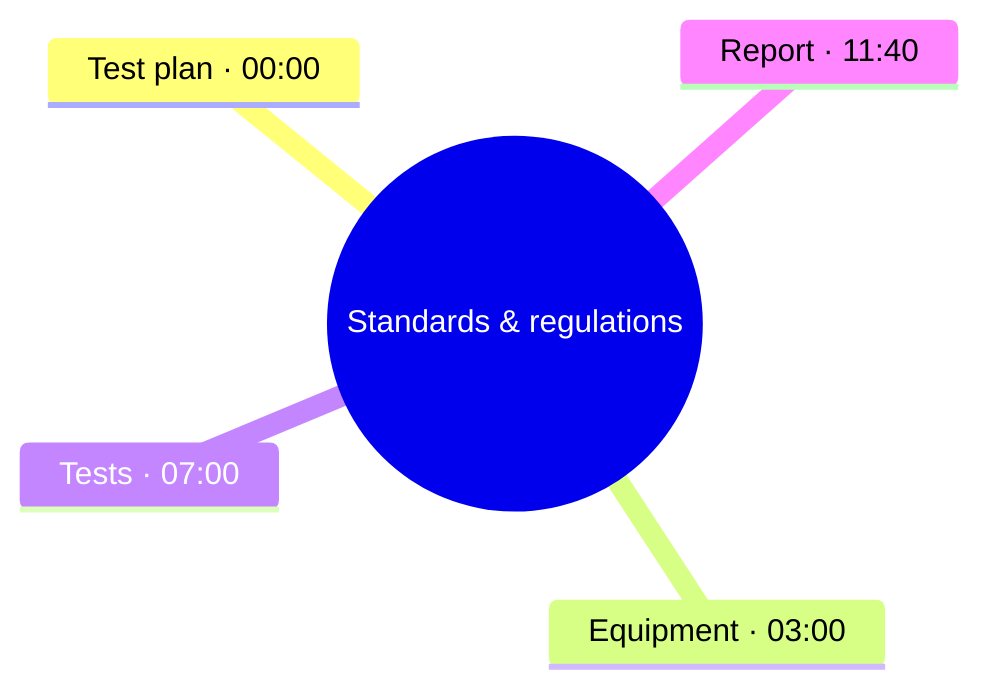

# Grid code compliance testing basics (Hindi)

## 0. Record
schema: vidledger/1
type: learning
video_id: demoHindi04
url: https://www.youtube.com/watch?v=demoHindi04
title: Grid code compliance testing basics (Hindi)
channel: Demo Urja Shiksha
published: 2025-06-12
duration: 16:00
spoken_languages: hi, en
category: Reference/How-to
topic: Standards & regulations
tags: 
difficulty: intermediate
prerequisites: 
processed_on: 2026-11-13
processed_by: Gemini (gemini-3.8-flash)
status: draft
my_rating: 
my_verdict: 

## 1. TL;DR
- Compliance testing follows an approved plan with calibrated equipment.
- Reports need raw data and plots for each test.

## 2. Rewatch only these
- [03:00](https://youtu.be/demoHindi04?t=180)-06:00 The core idea

## 3. Chapters
- [00:00](https://youtu.be/demoHindi04?t=0) Test plan
- [03:00](https://youtu.be/demoHindi04?t=180) Equipment
- [07:00](https://youtu.be/demoHindi04?t=420) Tests
- [11:40](https://youtu.be/demoHindi04?t=700) Report

## 4. Detailed notes

### Test plan ([00:00](https://youtu.be/demoHindi04?t=0))
- Key point about test plan. [00:30](https://youtu.be/demoHindi04?t=30)

### Equipment ([03:00](https://youtu.be/demoHindi04?t=180))
- Key point about equipment. [03:30](https://youtu.be/demoHindi04?t=210)

### Tests ([07:00](https://youtu.be/demoHindi04?t=420))
- Key point about tests. [07:30](https://youtu.be/demoHindi04?t=450)

### Report ([11:40](https://youtu.be/demoHindi04?t=700))
- Key point about report. [12:10](https://youtu.be/demoHindi04?t=730)

## 5. Visual notes

## 6. Mind map



## 7. Glossary

| Term | Meaning as explained in the video | Timestamp |
| --- | --- | --- |

## 8. Numbers, formulas, standards & references

## 9. Procedure
n/a

## 10. Claims to verify

## 11. Connections
- Prerequisites: -
- Learn next: -
- Related: -

## 12. Apply it

## 13. Explain-back

## 14. Flashcards

```csv
"What must the test report include?","Raw data and plots for every test, not just a summary. https://youtu.be/demoHindi04?t=700","standards-regulations vid_demoHindi04"
```

## 15. Quiz

1. What must the test report include?
    A. Raw data and plots for every test, not just a summary.
    B. None of these
    C. Both
    D. It depends on the weather

Answers
1. A: Raw data and plots for every test, not just a summary.

## 16. Reviewer checklist
- [ ] Spot-check [00:30](https://youtu.be/demoHindi04?t=30)

## 17. Transcript

[00:15](https://youtu.be/demoHindi04?t=15) नमस्ते। आज हम grid code compliance testing के basic steps देखेंगे।
EN: Hello. Today we will look at the basic steps of grid code compliance testing.
[02:32](https://youtu.be/demoHindi04?t=152) पहला step: test plan बनाइए और उसे transmission utility से approve करवाइए।
EN: First step: prepare the test plan and get it approved by the transmission utility.
[04:49](https://youtu.be/demoHindi04?t=289) दूसरा: measurement equipment की calibration certificate रखिए।
EN: Second: keep the calibration certificate of the measurement equipment.
[07:06](https://youtu.be/demoHindi04?t=426) फिर power quality, reactive power और ride-through tests होते हैं।
EN: Then come the power quality, reactive power and ride-through tests.
[09:23](https://youtu.be/demoHindi04?t=563) हर test के लिए उस दिन की grid condition record कीजिए।
EN: For every test, record that day's grid conditions.
[11:40](https://youtu.be/demoHindi04?t=700) Report में raw data और plots दोनों चाहिए, सिर्फ़ summary नहीं।
EN: The report needs both raw data and plots, not just a summary.
