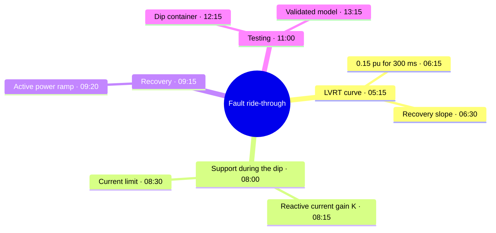

# Fault ride-through for wind turbines, explained

## 0. Record
schema: vidledger/1
type: learning
video_id: demoLVRT001
url: https://www.youtube.com/watch?v=demoLVRT001
title: Fault ride-through for wind turbines, explained
channel: Demo Grid Academy
published: 2025-06-12
duration: 18:00
spoken_languages: en
category: Learning
topic: Wind & grid integration
tags: lvrt, hvrt, frt, grid code
difficulty: intermediate
prerequisites: Per-unit system, Basic power electronics
processed_on: 2026-11-10
processed_by: Gemini (gemini-3.8-flash)
status: draft
my_rating: 
my_verdict: 

## 1. TL;DR
- Grid codes require wind plants to stay connected through voltage dips and support the voltage.
- Stay connected above the LVRT curve, inject reactive current during the dip, and restore active power at a set rate.
- Compliance is shown by field tests with a voltage-dip container plus a validated simulation model.

## 2. Rewatch only these
- [04:00](https://youtu.be/demoLVRT001?t=240)-07:00 The LVRT curve, read point by point
- [11:00](https://youtu.be/demoLVRT001?t=660)-13:20 How the dip container test works

## 3. Chapters
- [00:00](https://youtu.be/demoLVRT001?t=0) Why ride-through matters
- [04:00](https://youtu.be/demoLVRT001?t=240) The LVRT curve
- [08:00](https://youtu.be/demoLVRT001?t=480) Reactive current and recovery
- [11:00](https://youtu.be/demoLVRT001?t=660) Testing: field and simulation
- [15:00](https://youtu.be/demoLVRT001?t=900) Common mistakes and summary

## 4. Detailed notes

### Why ride-through matters ([00:00](https://youtu.be/demoLVRT001?t=0))
- Faults pull the voltage down for a few hundred milliseconds. [01:15](https://youtu.be/demoLVRT001?t=75)
- Mass disconnection of wind plants turns a small fault into a large generation loss. [02:15](https://youtu.be/demoLVRT001?t=135)

### The LVRT curve ([04:00](https://youtu.be/demoLVRT001?t=240))
- Above the curve the plant must stay connected; below it, it may trip. [05:15](https://youtu.be/demoLVRT001?t=315)
- Example: 0.15 pu for 300 ms, then a recovery slope. [06:15](https://youtu.be/demoLVRT001?t=375)

### Reactive current and recovery ([08:00](https://youtu.be/demoLVRT001?t=480))
- Reactive current = K x voltage deviation, up to the current limit. [08:15](https://youtu.be/demoLVRT001?t=495)
- Active power must recover within a set time after fault clearance. [09:15](https://youtu.be/demoLVRT001?t=555)

### Testing: field and simulation ([11:00](https://youtu.be/demoLVRT001?t=660))
- A voltage-dip container uses an impedance divider at the turbine terminals. [12:15](https://youtu.be/demoLVRT001?t=735)
- Simulation counts only with a model validated against measurements. [13:15](https://youtu.be/demoLVRT001?t=795)

## 5. Visual notes

### [05:30](https://youtu.be/demoLVRT001?t=330) · chart · Example LVRT curve
_Where the plant must stay connected_

| Time after fault (ms) | Minimum voltage (pu) |
|---|---|
| 0 | 0.15 |
| 300 | 0.15 |
| 3000 | 0.85 |

The plant must stay connected while the voltage is above the line.

### [08:20](https://youtu.be/demoLVRT001?t=500) · equation · Reactive current during a dip
_How much reactive current to inject_

Delta I_q: extra reactive current (pu); K: gain (typically 2); Delta U: voltage deviation from nominal (pu); I_max: converter limit.

```latex
\Delta I_q = K \cdot \Delta U, \quad |I_q| \le I_{max}
```

### [12:20](https://youtu.be/demoLVRT001?t=740) · diagram · Voltage-dip container
_How a field test creates the dip_

- Grid -> series impedance Z1 -> turbine terminals
- Switch S closes -> shunt impedance Z2 to earth
- Dip depth set by the ratio Z2 / (Z1 + Z2)

## 6. Mind map



## 7. Glossary

| Term | Meaning as explained in the video | Timestamp |
| --- | --- | --- |
| LVRT | Low-voltage ride-through: staying connected through a voltage dip | [03:20](https://youtu.be/demoLVRT001?t=200) |
| HVRT | High-voltage ride-through: staying connected through an overvoltage | [10:15](https://youtu.be/demoLVRT001?t=615) |
| pu | Per unit: a value as a fraction of its base value | [05:30](https://youtu.be/demoLVRT001?t=330) |

## 8. Numbers, formulas, standards & references
- value: 0.15 pu for 300 ms (example curve) [06:15](https://youtu.be/demoLVRT001?t=375)
- standard: IEC 61400-21-1 (power quality and grid compliance measurement) [11:40](https://youtu.be/demoLVRT001?t=700)
- regulation: CEA technical standards for connectivity to the grid [04:10](https://youtu.be/demoLVRT001?t=250)

## 9. Procedure
1. Agree the test plan and cases with the utility [11:20](https://youtu.be/demoLVRT001?t=680)
2. Run dip tests at low and high power [12:00](https://youtu.be/demoLVRT001?t=720)
3. Validate the model against the measurements [13:10](https://youtu.be/demoLVRT001?t=790)
4. Simulate the remaining cases with the validated model [13:40](https://youtu.be/demoLVRT001?t=820)

## 10. Claims to verify
- HVRT limits are often around 1.2 to 1.3 pu (Values differ between grid codes; check the one that applies) [10:15](https://youtu.be/demoLVRT001?t=615)

## 11. Connections
- Prerequisites: Per-unit system
- Learn next: Short-circuit ratio, Model validation
- Related: Reactive power capability

## 12. Apply it
- Check a turbine's FRT test report against the applicable curve, case by case
- Add the recovery ramp rate to your compliance checklist

## 13. Explain-back
- Why do grid codes require ride-through at all?
- What two things must a plant do during a dip?
- Why is a simulation alone not enough?

## 14. Flashcards

```csv
"What does LVRT require of a wind plant?","Stay connected while the voltage stays above the grid code's LVRT curve. https://youtu.be/demoLVRT001?t=200","wind-grid-integration vid_demoLVRT001"
"Why do grid codes require fault ride-through?","Mass disconnection during faults would turn a small fault into a large loss of generation. https://youtu.be/demoLVRT001?t=135","wind-grid-integration vid_demoLVRT001"
"How is reactive current during a dip usually set?","A gain K times the voltage deviation, up to the converter current limit. https://youtu.be/demoLVRT001?t=495","wind-grid-integration vid_demoLVRT001"
"What does a voltage-dip container use to create the dip?","An impedance divider: series impedance plus a switched shunt impedance at the turbine terminals. https://youtu.be/demoLVRT001?t=735","wind-grid-integration vid_demoLVRT001"
"When is a simulation accepted as compliance evidence?","Only when the model has been validated against field measurements. https://youtu.be/demoLVRT001?t=795","wind-grid-integration vid_demoLVRT001"
"Name two common plotting mistakes in FRT reports.","Using the wrong per-unit base, and checking only the depth of the dip but not its duration. https://youtu.be/demoLVRT001?t=950","wind-grid-integration vid_demoLVRT001"
```

## 15. Quiz

1. In the example curve, how deep and how long is the dip the plant must survive?
    A. 0.15 pu for 300 ms
    B. 0.5 pu for 3 s
    C. 0 pu for 1 s
    D. 0.9 pu for 10 ms

2. What should the plant do during the dip besides staying connected?
    A. Trip quickly
    B. Inject reactive current
    C. Raise frequency
    D. Reduce the voltage

3. What makes simulation results acceptable?
    A. Any software
    B. A validated model
    C. A short report
    D. A higher gain K

Answers
1. A: The example curve holds 0.15 pu for 300 ms.
2. B: Reactive current supports the voltage.
3. B: The model must be validated against measurements.

## 16. Reviewer checklist
- [ ] Unclear: [10:15](https://youtu.be/demoLVRT001?t=615) High-voltage ride-through is the mirror image: overvoltages after a fault, often up to about 1.2 or 1.3 per unit for a short time (?).
- [ ] Spot-check [06:15](https://youtu.be/demoLVRT001?t=375)
- [ ] Spot-check [08:15](https://youtu.be/demoLVRT001?t=495)
- [ ] Spot-check [12:15](https://youtu.be/demoLVRT001?t=735)
- [ ] Term to confirm: HVRT limit values

### Added context
- Per unit: 1 pu is the nominal value; 0.15 pu means 15 percent of nominal voltage.

## 17. Transcript

[00:15](https://youtu.be/demoLVRT001?t=15) S1: Welcome. Today we look at fault ride-through: what a wind turbine must do when the grid voltage dips.
[01:15](https://youtu.be/demoLVRT001?t=75) S1: When a fault happens somewhere on the network, the voltage at the connection point can fall to a small fraction of normal for a few hundred milliseconds.
[02:15](https://youtu.be/demoLVRT001?t=135) S1: Older turbines simply disconnected. With a lot of wind on the system, that would turn a small fault into a large loss of generation.
[03:15](https://youtu.be/demoLVRT001?t=195) S1: So grid codes ask the plant to stay connected. That is low-voltage ride-through, LVRT.
[04:15](https://youtu.be/demoLVRT001?t=255) S1: Here is the curve. Time on the horizontal axis, voltage in per unit on the vertical axis.
[05:15](https://youtu.be/demoLVRT001?t=315) S1: Above the line the plant must stay connected. Below it, it may trip.
[06:15](https://youtu.be/demoLVRT001?t=375) S1: In this example curve, the voltage can fall to 0.15 per unit for 300 milliseconds, then must recover along this slope.
[07:15](https://youtu.be/demoLVRT001?t=435) S1: Staying connected is not enough. During the dip the plant should also inject reactive current to support the voltage.
[08:15](https://youtu.be/demoLVRT001?t=495) S1: The reactive current is usually a gain, K, times the voltage deviation, um, up to the converter's current limit.
[09:15](https://youtu.be/demoLVRT001?t=555) S1: After the fault clears, active power must come back within a set time. Too fast can shake the grid; too slow loses energy.
[10:15](https://youtu.be/demoLVRT001?t=615) S1: High-voltage ride-through is the mirror image: overvoltages after a fault, often up to about 1.2 or 1.3 per unit for a short time (?).
[11:15](https://youtu.be/demoLVRT001?t=675) S1: Now, how do we test this? Two ways: a field test with a voltage-dip container, and simulation with a validated model.
[12:15](https://youtu.be/demoLVRT001?t=735) S1: The container uses an impedance divider to create the dip at the turbine terminals without disturbing the whole grid.
[13:15](https://youtu.be/demoLVRT001?t=795) S1: Simulation results are only accepted when the model has been validated against those measurements.
[14:15](https://youtu.be/demoLVRT001?t=855) S1: A typical report shows voltage, active power and reactive current for each test case, on one page per case.
[15:15](https://youtu.be/demoLVRT001?t=915) S1: Common mistakes: plotting the wrong per-unit base, and checking only the depth of the dip but not its duration.
[16:15](https://youtu.be/demoLVRT001?t=975) S1: To sum up: stay connected above the curve, support the voltage during the dip, and recover active power at the right rate.
