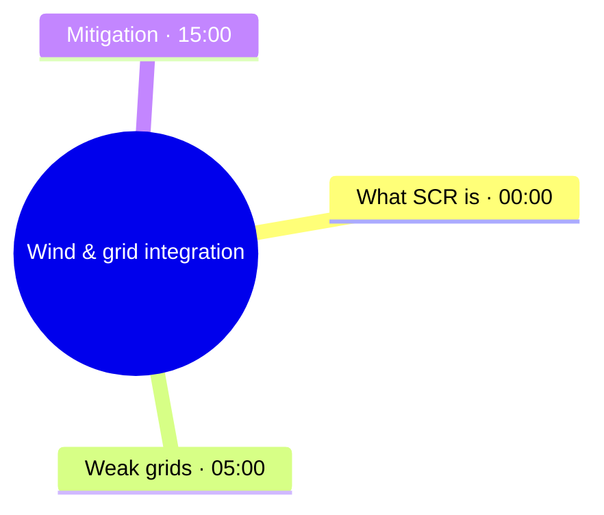

# Short-circuit ratio and weak grids

## 0. Record
schema: vidledger/1
type: learning
video_id: demoSCR0002
url: https://www.youtube.com/watch?v=demoSCR0002
title: Short-circuit ratio and weak grids
channel: Demo Power Lab
published: 2025-06-12
duration: 24:00
spoken_languages: en
category: Learning
topic: Wind & grid integration
tags: 
difficulty: intermediate
prerequisites: 
processed_on: 2026-11-11
processed_by: Gemini (gemini-3.8-flash)
status: draft
my_rating: 
my_verdict: 

## 1. TL;DR
- SCR compares grid strength with plant size.
- Below about 3, converter control needs extra care.

## 2. Rewatch only these
- [05:00](https://youtu.be/demoSCR0002?t=300)-08:00 The core idea

## 3. Chapters
- [00:00](https://youtu.be/demoSCR0002?t=0) What SCR is
- [05:00](https://youtu.be/demoSCR0002?t=300) Weak grids
- [15:00](https://youtu.be/demoSCR0002?t=900) Mitigation

## 4. Detailed notes

### What SCR is ([00:00](https://youtu.be/demoSCR0002?t=0))
- Key point about what scr is. [00:30](https://youtu.be/demoSCR0002?t=30)

### Weak grids ([05:00](https://youtu.be/demoSCR0002?t=300))
- Key point about weak grids. [05:30](https://youtu.be/demoSCR0002?t=330)

### Mitigation ([15:00](https://youtu.be/demoSCR0002?t=900))
- Key point about mitigation. [15:30](https://youtu.be/demoSCR0002?t=930)

## 5. Visual notes

## 6. Mind map



## 7. Glossary

| Term | Meaning as explained in the video | Timestamp |
| --- | --- | --- |

## 8. Numbers, formulas, standards & references

## 9. Procedure
n/a

## 10. Claims to verify

## 11. Connections
- Prerequisites: -
- Learn next: -
- Related: -

## 12. Apply it

## 13. Explain-back

## 14. Flashcards

```csv
"What does SCR compare?","The short-circuit power at the connection point with the plant's rated power. https://youtu.be/demoSCR0002?t=120","wind-grid-integration vid_demoSCR0002"
"Why do weak grids worry converter control?","Voltage swings more with power changes, so control loops can become unstable. https://youtu.be/demoSCR0002?t=520","wind-grid-integration vid_demoSCR0002"
```

## 15. Quiz

1. What does SCR compare?
    A. The short-circuit power at the connection point with the plant's rated power.
    B. None of these
    C. Both
    D. It depends on the weather

Answers
1. A: The short-circuit power at the connection point with the plant's rated power.

## 16. Reviewer checklist
- [ ] Spot-check [00:30](https://youtu.be/demoSCR0002?t=30)

## 17. Transcript

[00:15](https://youtu.be/demoSCR0002?t=15) S1: Short-circuit ratio compares the grid's strength with the size of the plant.
[06:15](https://youtu.be/demoSCR0002?t=375) S1: A low ratio means the voltage moves a lot when power changes.
[12:15](https://youtu.be/demoSCR0002?t=735) S1: Grid-forming control and synchronous condensers are two common fixes.
