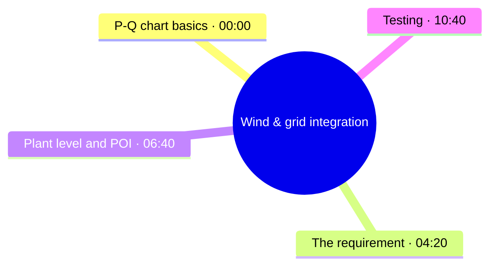

# Reactive power capability - Tamil explainer

## 0. Record
schema: vidledger/1
type: learning
video_id: demoTamil03
url: https://www.youtube.com/watch?v=demoTamil03
title: Reactive power capability - Tamil explainer
channel: Demo Tamil Engineering
published: 2025-06-12
duration: 21:00
spoken_languages: ta, en
category: Learning
topic: Wind & grid integration
tags: 
difficulty: intermediate
prerequisites: 
processed_on: 2026-11-12
processed_by: Gemini (gemini-3.8-flash)
status: draft
my_rating: 
my_verdict: 

## 1. TL;DR
- The P-Q chart must cover the grid code's power-factor range at the point of interconnection.
- Include cable and transformer losses; add a STATCOM or capacitors if there is a gap.

## 2. Rewatch only these
- [04:20](https://youtu.be/demoTamil03?t=260)-07:20 The core idea

## 3. Chapters
- [00:00](https://youtu.be/demoTamil03?t=0) P-Q chart basics
- [04:20](https://youtu.be/demoTamil03?t=260) The requirement
- [06:40](https://youtu.be/demoTamil03?t=400) Plant level and POI
- [10:40](https://youtu.be/demoTamil03?t=640) Testing

## 4. Detailed notes

### P-Q chart basics ([00:00](https://youtu.be/demoTamil03?t=0))
- Key point about p-q chart basics. [00:30](https://youtu.be/demoTamil03?t=30)

### The requirement ([04:20](https://youtu.be/demoTamil03?t=260))
- Key point about the requirement. [04:50](https://youtu.be/demoTamil03?t=290)

### Plant level and POI ([06:40](https://youtu.be/demoTamil03?t=400))
- Key point about plant level and poi. [07:10](https://youtu.be/demoTamil03?t=430)

### Testing ([10:40](https://youtu.be/demoTamil03?t=640))
- Key point about testing. [11:10](https://youtu.be/demoTamil03?t=670)

## 5. Visual notes

## 6. Mind map



## 7. Glossary

| Term | Meaning as explained in the video | Timestamp |
| --- | --- | --- |

## 8. Numbers, formulas, standards & references

## 9. Procedure
n/a

## 10. Claims to verify

## 11. Connections
- Prerequisites: -
- Learn next: -
- Related: -

## 12. Apply it

## 13. Explain-back

## 14. Flashcards

```csv
"Where is reactive capability checked for compliance?","At the point of interconnection (POI), including plant losses. https://youtu.be/demoTamil03?t=400","wind-grid-integration vid_demoTamil03"
"What power factor range is required at rated power in this video?","0.95 lagging to 0.95 leading. https://youtu.be/demoTamil03?t=260","wind-grid-integration vid_demoTamil03"
"How is a reactive capability gap usually closed?","With a STATCOM or a capacitor bank. https://youtu.be/demoTamil03?t=520","wind-grid-integration vid_demoTamil03"
```

## 15. Quiz

1. Where is reactive capability checked for compliance?
    A. At the point of interconnection (POI), including plant losses.
    B. None of these
    C. Both
    D. It depends on the weather

Answers
1. A: At the point of interconnection (POI), including plant losses.

## 16. Reviewer checklist
- [ ] Unclear: [09:45](https://youtu.be/demoTamil03?t=585) Low power-ல converter limit காரணமா capability குறையலாம் (?).
- [ ] Spot-check [00:30](https://youtu.be/demoTamil03?t=30)

## 17. Transcript

[00:15](https://youtu.be/demoTamil03?t=15) வணக்கம். இன்று reactive power capability பற்றி பார்க்கலாம்.
EN: Hello. Today let us look at reactive power capability.
[02:09](https://youtu.be/demoTamil03?t=129) ஒரு wind turbine எவ்வளவு reactive power கொடுக்க முடியும் என்பதை P-Q chart காட்டுகிறது.
EN: The P-Q chart shows how much reactive power a wind turbine can give.
[04:03](https://youtu.be/demoTamil03?t=243) Horizontal axis-ல reactive power, vertical axis-ல active power.
EN: Reactive power is on the horizontal axis, active power on the vertical axis.
[05:57](https://youtu.be/demoTamil03?t=357) Grid code சொல்லுது: rated power-ல 0.95 lagging முதல் 0.95 leading வரை power factor வேண்டும்.
EN: The grid code says: at rated power, the power factor must range from 0.95 lagging to 0.95 leading.
[07:51](https://youtu.be/demoTamil03?t=471) இந்த rectangle மாதிரி area தான் requirement. Turbine-ன் curve அதை cover பண்ணணும்.
EN: This rectangle-like area is the requirement. The turbine's curve must cover it.
[09:45](https://youtu.be/demoTamil03?t=585) Low power-ல converter limit காரணமா capability குறையலாம் (?).
EN: At low power, capability may reduce because of the converter limit (?).
[11:39](https://youtu.be/demoTamil03?t=699) Plant level-ல cable, transformer losses எல்லாம் சேர்த்து point of interconnection-ல check பண்ணணும்.
EN: At plant level, include cable and transformer losses and check at the point of interconnection.
[13:33](https://youtu.be/demoTamil03?t=813) அதனால தான் சில நேரம் STATCOM அல்லது capacitor bank சேர்க்கிறோம்.
EN: That is why we sometimes add a STATCOM or a capacitor bank.
[15:27](https://youtu.be/demoTamil03?t=927) Test-ல ஒவ்வொரு power level-லும் maximum lagging, maximum leading reactive power measure பண்ணுவோம்.
EN: In the test, we measure maximum lagging and maximum leading reactive power at each power level.
[17:21](https://youtu.be/demoTamil03?t=1041) சுருக்கமா: chart-ஐ சரியா படிங்க, POI-ல check பண்ணுங்க, gap இருந்தா compensation plan பண்ணுங்க.
EN: In short: read the chart correctly, check at the POI, and plan compensation if there is a gap.
